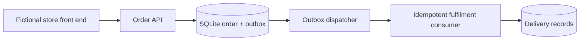

# Cloud Integration Architecture | Event-Driven Order Processing

An **original, runnable integration reference** for a fictional online stationery store, PaperTrail. The purpose is to demonstrate API boundaries, asynchronous processing, idempotency, reliability and cloud deployment choices.

> This is an independent portfolio exercise. All organisations, names, flows and sample data are fictional. It contains no previous employer or client material.

## What works now

A standard-library-only Python prototype models accepting an order through a service API, storing it with a transactional outbox record, and asynchronously delivering it to an idempotent fulfilment handler via an in-process simulation. SQLite provides transactional persistence. It is a local proof of concept, **not** a deployed AWS/Azure integration.

## Quick start

Python 3.10+ required; no packages to install.

```bash
python -m unittest discover -s tests -v
python -m app.demo
```

The demo prints example order and outbox delivery statistics.

## Architecture



## Portfolio navigation

- [Architecture design](docs/architecture.md): patterns, trust boundaries and cloud alternatives.
- [API contract](docs/api-contract.yaml): draft OpenAPI contract for a future HTTP adapter.
- [Reliability and security](docs/reliability.md): failures, retries, threat model and production gaps.
- [ADR-001](docs/adrs/0001-outbox.md): transactional outbox versus direct broker publish.
- [Runbook](docs/runbook.md): local testing and suggested operations.
- [Tests](tests/test_integration.py): duplicate requests, event replay, rollback and delivery.

## Cloud deployment variants (not implemented)

**AWS:** API Gateway → Lambda/container service → RDS PostgreSQL → outbox relay → SQS/EventBridge → fulfilment worker.

**Azure:** API Management → Container Apps/Functions → Azure Database for PostgreSQL → outbox relay → Service Bus → fulfilment worker.

These are design options, not claims of implementation or equivalence. A production build must implement managed identity, schema governance, telemetry, retries, dead-letter management, backups, HA, privacy controls and cloud-specific IaC.

## License

MIT.
