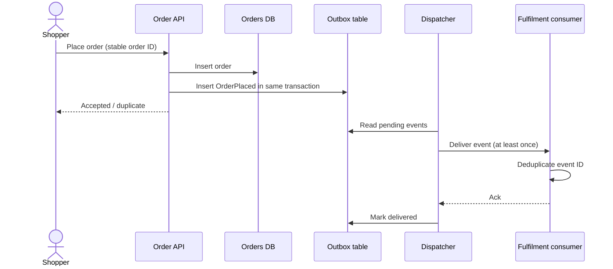

# Architecture design

## Business context

PaperTrail is a fictional stationery retailer whose e-commerce frontend places small orders. Fulfilment processing should be decoupled from the customer-facing request, with replay-safe event handling.

## Logical design

**Consistency:** Order and outbox event are committed together. External delivery is asynchronous and may be duplicated. The consumer stores processed event IDs transactionally alongside fulfilment.

**Contracts:** The future HTTP adapter will implement the draft OpenAPI specification. The local proof-of-concept exposes Python functions only and does not start a web server.

**Boundaries:** Frontend → authenticated API → isolated order store → relay/broker → worker. Do not expose direct database access. Prefer per-service identity and narrow database privileges in deployed environments.

## Design options

| Dimension | AWS option | Azure option | Selection criterion |
| --- | --- | --- | --- |
| API edge | API Gateway | API Management | Auth, policies, operations cost |
| Compute | Lambda / ECS | Functions / Container Apps | Execution model and team skills |
| Persistence | RDS PostgreSQL | Azure Database for PostgreSQL | HA, recovery and network controls |
| Messaging | SQS / EventBridge | Service Bus | Delivery requirements and routing |
| Identity | IAM roles | Managed identity | Least privilege and auditability |
| Monitoring | CloudWatch + tracing | Azure Monitor + tracing | End-to-end correlation |

Neither cloud architecture is provisioned in this repository.
